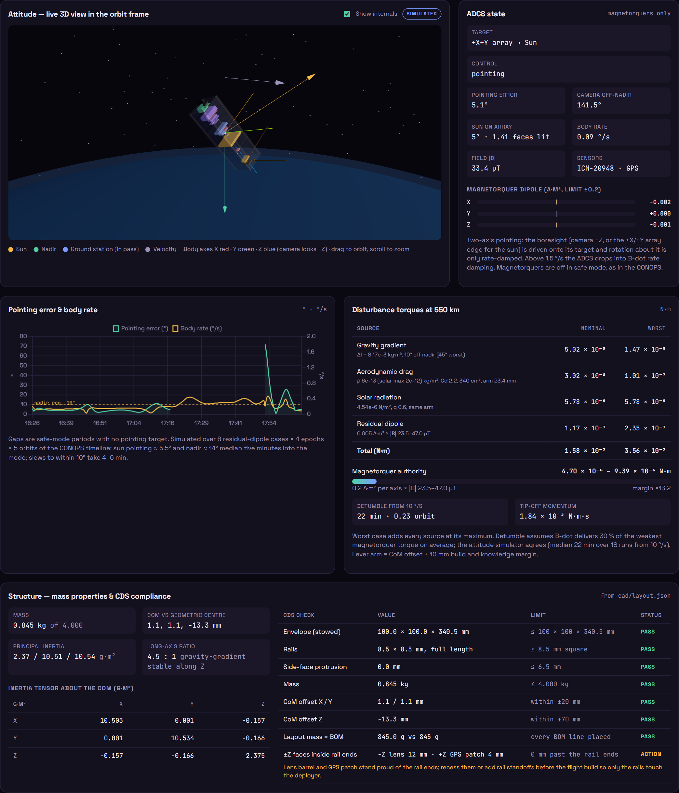

# MARSAD-1 · Mission Dashboard

**Team Kanban (BSSDT4) — SatForge UAE 2026 National University Satellite Engineering Challenge**

MARSAD-1 (مرصد, "observatory") is a 3U CubeSat in a 550 km sun-synchronous orbit that maps
harmful algal blooms (red tides) and chlorophyll-a along the UAE coast of the Arabian Gulf and
Gulf of Oman, giving desalination plants, fisheries and coastal authorities early warning.

**Live dashboard:** https://4waiz.github.io/marsad-1-dashboard/


## Deliverables

| Item | Link |
|---|---|
| Live dashboard | https://4waiz.github.io/marsad-1-dashboard/ |
| Tinkercad circuit | https://www.tinkercad.com/things/cY2kWDnTdZB |
| Tinkercad 3D design | https://www.tinkercad.com/things/4Qi0WBiqTus |
| Simulation video | https://4waiz.github.io/marsad-1-dashboard/video/MARSAD-1_simulation.mp4 |
| Prototype demo video | https://4waiz.github.io/marsad-1-dashboard/video/MARSAD-1_prototype_demo.mp4 |
| Recorded presentation (3:57) | https://4waiz.github.io/marsad-1-dashboard/video/MARSAD-1_presentation.mp4 |
| Phase 1 report (PDF) | https://4waiz.github.io/marsad-1-dashboard/report/MARSAD-1_Phase1_Report.pdf |
| Phase 1 report (web) | https://4waiz.github.io/marsad-1-dashboard/report/ |
| A2 poster (PNG) | https://4waiz.github.io/marsad-1-dashboard/poster/MARSAD-1_poster_A2.png |
| Final technical report (PDF) | https://4waiz.github.io/marsad-1-dashboard/report/final/MARSAD-1_Final_Technical_Report.pdf |
| Final technical report (web) | https://4waiz.github.io/marsad-1-dashboard/report/final/ |
| Final poster (Canva) | https://canva.link/66027wdcw95hqls |
| Social reel (portrait, 86 s) | https://4waiz.github.io/marsad-1-dashboard/video/reel-social/marsad-1-reel.mp4 |
| Reel on YouTube / Instagram / TikTok / LinkedIn | https://youtube.com/shorts/IT2QI0FCNoo · https://www.instagram.com/4waaiz/reel/DfNJYa2uLlq/ · https://www.tiktok.com/@kanbanstudios.ae/video/7703241154233371911 · https://www.linkedin.com/feed/update/urn:li:activity:7522697267234111490/ |

Sources: `cad/` (STL generator, Blender render script, structural layout and mass-properties script), `poster/` (HTML poster + charts), `report/`, `video/` (kanban-motion reel, voiceover script, cue sheet).
The poster hero image was generated with ChatGPT image generation; the simulation video narration is synthetic (Kokoro).
In the prototype demo video, the lab and orbit shots are AI-generated visualisations of the planned hardware build (ChatGPT images animated with Vidu) and are labelled as such on screen. The Tinkercad simulation and the dashboard fault-injection tests are real screen recordings. Edit sources are in `video/demo/` (`build.sh`, `script.txt`, `cues.json`).
The recorded presentation uses a synthetic narrator (Kokoro); its slides, script and build script are in `video/presentation/`.
The social reel uses the same synthetic narrator and labels each shot on screen as an AI visualisation, a real recording or a Blender render; its captions are in `video/reel-social/meta.json`.

## What the dashboard shows

| Section | Contents |
|---|---|
| Header | Mission name, link state (SIM / LIVE · USB / STALE / LINK LOST), last-packet age, active-alarm badge, mission UTC |
| Status | Eight status tiles (mode, SoC, bus voltage, battery/internal/panel temperature, load, storage) with units, limits, a gauge with nominal/warning/critical zones and a text status word |
| Alarms & readings | Latched alarms with UTC timestamps and acknowledge, alarm history, fault injection (low battery, cold battery, link loss, sensor glitch, magnetorquer tumble), and a latest-readings table with limits, status and per-field age |
| Data contract | The JSON-lines packet format (fields, types, units, limits, required) shared by the simulator, the Tinkercad sketch and the ESP32-S3 firmware |
| Operations | Live ground track (SSO propagator), spacecraft state, eclipse, Abu Dhabi ground-station passes, current CONOPS mode, subsystem status, event log |
| ADCS & structure | Live 3D attitude view in the orbit frame (the team's STL model with sun, nadir and ground-station vectors, and an internals x-ray), ADCS state (target, pointing error, off-nadir angle, sun on the array, body rate, field, magnetorquer dipoles), pointing-error chart, disturbance-torque budget against magnetorquer authority, mass properties and CubeSat Design Specification checks |
| Telemetry | Battery state of charge, generated vs consumed power, internal/battery/panel temperatures, onboard storage — simulated from the design budgets, or live from the prototype over USB |
| Bloom watch | Chlorophyll-a (NDCI) map over UAE waters and alert status for desalination plants and fisheries (demo field until prototype imagery is processed) |
| CONOPS | 95-min orbit timeline (40 min sun-pointing, 10 min imaging, 10 min ground pass, 35 min eclipse) and the component × mode matrix |
| Budgets | Power, energy per mode, mass, cost by subsystem, and margins |
| Components | Full bill of materials (17 line items) |
| Mission & team | Mission statement, success criteria, orbit, team roles |

Time warp (1×–300×) speeds the simulation up so a full orbit can be watched in a few minutes.

**Status colours:** green = nominal, amber = warning, red = critical, grey = stale or no data, violet = invalid value. The status is always written out as well, so colour is never the only cue.
A field goes stale 3 s after its last update; no packets for 3 s marks the link STALE and for 10 s LINK LOST.
Values outside the sensor's physical range or of the wrong type are flagged INVALID and never plotted. Chart lines break where data is missing.

**Testing:** use the fault-injection buttons. They act on the simulated spacecraft, so the dashboard only sees the resulting packets.

## Design summary

| Budget | Value | Limit / margin |
|---|---|---|
| Power | 3.92 W load (all-on), 3.02 Wh per orbit | 6 × 1.1 W cells = 6.6 W → +2.68 W |
| Mass | 0.845 kg | 4.0 kg (3U) → 3.16 kg margin |
| Volume | 500.6 cm³ | 3000 cm³ |
| Cost | 1,420 AED | 3,000 AED → 1,580 AED margin |
| Data | 75 MB/day generated, 1.42 MB/day downlinked | 2 GB onboard |

## ADCS & structure (Bilal Feroz)



**Structural layout.** `cad/layout.json` places every BOM line in the 3U frame (mm; CAD axes = body axes; −Z is the nadir/camera face, +Z the zenith face with the GPS patch and antenna hinges). The 450 g frame is split into four rails, two end plates and two separator rings, and the six body-mounted panels are modelled as four face skins. Battery, heater and EPS boards sit in U1 next to the payload; the OBC, SD card, IMU and magnetorquer board in U2; the radio, GPS and antenna hinges in U3. `cad/make_cubesat.py` turns the same layout into `internals.stl`, and the dashboard and `cad/mass_properties.py` compute the numbers below from it (they agree to every printed digit).

| Mass properties | Value |
|---|---|
| Mass | 0.845 kg (layout = BOM, line by line) |
| CoM offset from geometric centre | +1.1, +1.1, −13.3 mm (CDS limits ±20, ±20, ±70 mm) |
| Principal inertia | 2.37, 10.51, 10.54 g·m² (long axis 4.5× smaller, so gravity gradient holds Z on nadir) |

CDS checks: envelope 100 × 100 × 340.5 mm, 8.5 mm rails, no side-face protrusion, mass and CoM all pass. **Action:** the lens barrel stands 12 mm past the −Z rail ends and the GPS patch 4 mm past +Z; recess them or add rail standoffs before the flight build so only the rails touch the deployer.

**Disturbance budget at 550 km** (worst case, every source at its maximum): gravity gradient 1.5 × 10⁻⁸, aerodynamic 1.0 × 10⁻⁷ (solar maximum), solar radiation 5.8 × 10⁻⁹ and residual dipole 2.3 × 10⁻⁷ N·m, 3.6 × 10⁻⁷ N·m in total. The magnetorquers (0.2 A·m² per axis) give 4.7–9.4 × 10⁻⁶ N·m, a ×13 margin. Detumbling from a 10 °/s tip-off takes about 22 min (0.23 orbit).

Assumptions: density 6 × 10⁻¹³ kg/m³ (2 × 10⁻¹² at solar maximum), Cd 2.2, 340 cm² largest face, lever arm = CoM offset + 10 mm, solar pressure 4.54 × 10⁻⁶ N/m² with reflectance 0.6, residual dipole 0.005 A·m² in the budget and 0.002 A·m² in the simulation, aligned-dipole field (B0 = 30.1 µT), B-dot delivering 30 % of the weakest magnetorquer torque on average.

**Attitude control, magnetorquers only.** `js/attitude.js` integrates the rigid-body dynamics (RK4, steps of 1 s or less) with gravity-gradient and residual-dipole torques. Targets follow the CONOPS mode: sun → the +X/+Y array edge on the sun, nadir → the −Z camera on nadir, ground pass → −Z on the Abu Dhabi station, safe → magnetorquers off (as in the power budget). Pointing is two-axis: the boresight is driven onto its target by a rate-limited PD loop (0.7 °/s) and the dipole is picked by least squares on angular acceleration, so the torque the coils cannot make (along B) is not dumped onto the low-inertia long axis. Above 1.5 °/s the ADCS falls back to B-dot rate damping (gain 12·n·I_min, the fastest in a sweep).

Simulated over 8 orientations of the residual dipole × 4 epochs × 5 orbits of the CONOPS timeline (40 min sun, 10 nadir, 10 ground pass, 35 safe); median of the 8 cases, range in brackets:

| Mode | Error 5 min into the mode | Time within 10° (whole window) | Time to reach 10° |
|---|---|---|---|
| Sun pointing | 5.5° (4.4–6.6°) | 66 % (59–73 %) | 6.2 min (5.0–7.3) |
| Nadir imaging | 14° (9.5–21°) | 27 % (23–36 %) | 4.3 min (3.9–6.0) |
| Ground-station track | 20° (15–22°) | 26 % (17–27 %) | — |

Body rate stays under the 1.5 °/s damping threshold at least 97.6 % of the time and never reaches the 2 °/s warning in normal operations. **Finding:** a coils-only ADCS holds the sun well but does **not** meet the 10° nadir requirement for most of the 10-min imaging window: the slew out of the sun attitude takes ~4 min and the coils cannot torque about the field direction. Starting the nadir slew about 5 min before the UAE window, or adding one small momentum wheel, are the two fixes proposed for the next design iteration.

Telemetry gains two optional contract fields: `rate` (body rate; warning above 2 °/s, critical above 4 °/s) and `perr` (pointing error; information only, omitted in safe mode). The **Magnetorquer fault (tumble)** button spins the spacecraft up to about 5.6 °/s with the coils off (critical alarm); release it and B-dot brings the rate back under 2 °/s in about 12 simulated minutes.

The 3D view draws the team's STL parts about the centre of mass in the orbit frame (along-track to the right, zenith up, Earth below at the true altitude-to-radius ratio). **Show internals** makes the skin translucent and shows the layout boxes coloured by subsystem. Three.js 0.160 is loaded from jsDelivr only for this view; the rest of the dashboard works without it.

Regenerate the CAD parts and the numbers:

```
python cad/make_cubesat.py      # STL parts, including internals.stl
python cad/mass_properties.py   # mass properties, CDS checks, disturbance budget
```

## Tinkercad circuit

**Circuit:** https://www.tinkercad.com/things/cY2kWDnTdZB — *Team Kanban – Circuit Design - Awaiz Ahmed*

Arduino Uno stand-in for the flight computer (`firmware/tinkercad_prototype/tinkercad_prototype.ino`):

| Pin | Part | Role |
|---|---|---|
| A0 | TMP36 | Battery temperature |
| A1 | Photoresistor + 10 kΩ pull-down | Sun sensor (sunlit / eclipse) |
| A3 | Potentiometer (3.3 V) | Battery-voltage stand-in → state of charge |
| D13 | Red LED + 220 Ω | Battery heater |
| D7 | Green LED + 220 Ω | Payload imaging (nadir mode) |
| D4 | Blue LED + 220 Ω | UHF downlink / ground pass |
| D9 | Micro servo | Antenna deployment (5 s after boot) |

The sketch runs the CONOPS mode logic (safe / sun-pointing / nadir imaging / ground pass) and prints the same
JSON telemetry the dashboard reads.

## Prototype link

`firmware/marsad_telemetry/marsad_telemetry.ino` runs on the ESP32-S3 and prints one JSON line per
second following the data contract (`soc`, `v`, `load`, `tint`, `tbat`, `ndci`, `heater`, …). Open the dashboard in Chrome or Edge,
plug the board in, and press **Connect prototype (USB)** — the telemetry panels switch to live data.

## Team

- **Awaiz Ahmed** — Mission lead, CDHS & flight software, dashboard
- **Mohammad Umar** — EPS lead, power budget & solar array
- **Bilal Feroz** — ADCS & structure, 3D design
- **Maryam Alnaqbi** — Payload & comms, bloom science

## Run locally

Any static server works, e.g. `python -m http.server` in this folder, then open http://localhost:8000.
